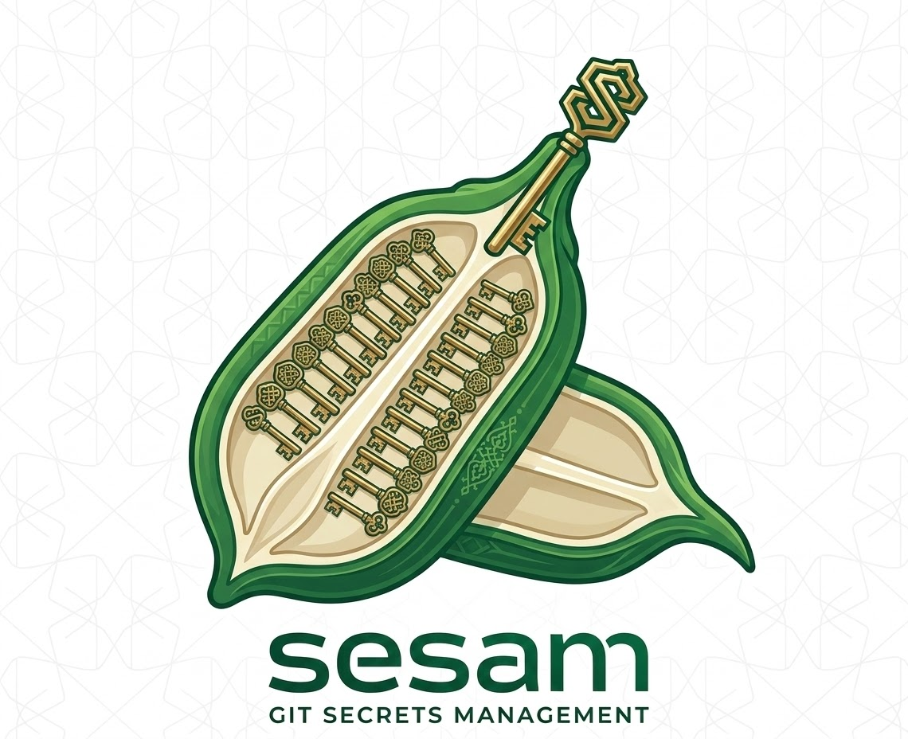

# sesam: A clever git secrets manager

<b>Encrypted, multi-user secrets that live in your git repo</b>

  <a href="https://opensesam.org/docs/">Documentation</a> ·
  <a href="https://opensesam.org/docs/installation.html">Installation</a> ·
  <a href="https://opensesam.org/docs/alternatives.html">Alternatives</a> ·
  <a href="https://github.com/open-sesam/sesam/blob/main/CHANGELOG.md">Changelog</a>

> [!WARNING]  
> This software is not at version 1.0. It works well enough for us (we use it at our company), but consider it as open beta.
> There is no guarantee before v1.0 that APIs and storage will stay fully backwards compatible, although we aim to avoid that.
> Use at your own risk for now. If you decide to already use it, then we would be happy about short feedback on your use-case.

# What is it?

`sesam` is a tool to manage `secret` (as in encrypted) files in `git`, so that
no unauthorised persons have access to them. Other than a password manager,
which targets a single user, it is targeting teams that need access to a set of
secrets. It is more capable [than existing decentralized secret
managers](https://opensesam.org/docs/alternatives.html) and provides a large
number of convenience features.

## Features

- Modern, multi-user cryptography with [age](https://github.com/FiloSottile/age).
- Support for SSH keys, age keys and age plugin identities.
- Easy support for multiple users with different access levels.
- Signed, hash chained, encrypted audit log for user, access and secret changes.
- Well integrated with `git` (diffs, merge, checkout and hooks).
- Decentralized like `git` - you get versioning and hosting for free.
- Wide range of verification and tampering detection thanks to audit log.
- Integration with popular forges like GitHub, GitLab and codeberg.
- Ergonomic, easy-to-understand CLI with built-in help and completion.
- Imperative (CLI) and declarative (Config) workflows are supported.
- Simple modern deployment with a static binary.
- Highly scriptable and even usable as Go library.
- Password manager like features.

## Planned features

- Rotation and exchange of secrets.
- Better support for env-file based workflows.

# Quickstart Links

- [Documentation](https://opensesam.org/docs/)
- [Installation](https://opensesam.org/docs/installation.html)
- [Contributing](https://github.com/open-sesam/sesam/blob/main/CONTRIBUTING.md)
- [Changelog](https://github.com/open-sesam/sesam/blob/main/CHANGELOG.md)
- [Releases](https://github.com/open-sesam/sesam/releases)
- [License](https://github.com/open-sesam/sesam/blob/main/LICENSE)
- [Alternatives](https://opensesam.org/docs/alternatives.html)
- [Design](https://opensesam.org/docs/design.html)

# AI Disclaimer

Those are weird times for software developers, therefore we feel obliged to note down how `sesam` is being developed.
We use AI-based assistants so far for:

- Reviewing / Auditing.
- Ideation / Design feedback.
- Building test suites.
- Writing HTML/CSS.
- Occasional clearly scoped code change (ex: merge and apply features).

The majority of core code is still hand-written to make sure we don't lose touch
to what we build. To be clear: **This is not a vibe-coded project.** The design
was done by an experienced software engineer the old-fashioned way. If you want
to read more about our stance regarding AI-usage in software development you can read
some [slides](https://sahib.github.io/misc/the-vibes-that-i-summoned/slides.pdf) here ([with notes](https://sahib.github.io/misc/the-vibes-that-i-summoned/slides-with-notes.pdf)).
